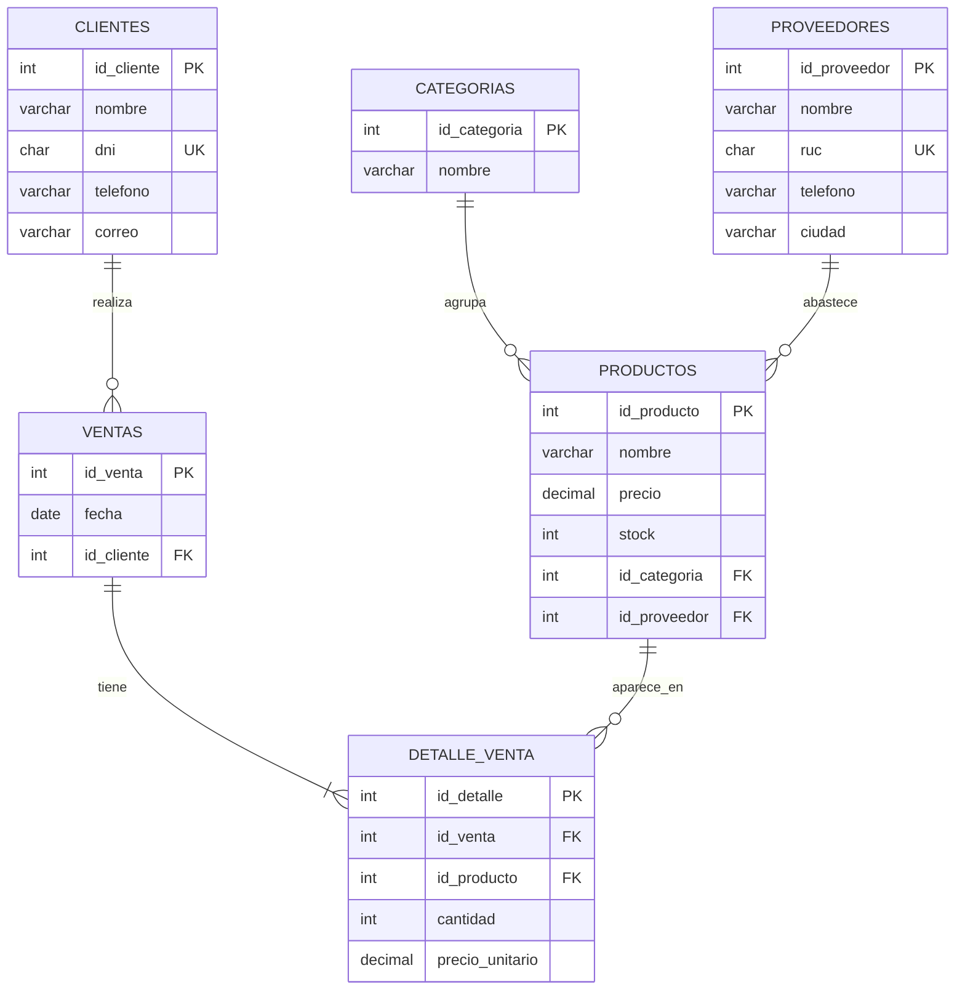

# Sistema de gestión para una librería

Proyecto académico que cubre una tienda de útiles escolares de punta a punta: una base de datos relacional, un sistema de inventario y ventas en Python, y una API REST con su interfaz web.

**Tecnologías:** Python · SQLite · SQL · Flask · HTML · CSS · JavaScript

## Estructura

| Carpeta | Contenido |
|---|---|
| `base_de_datos/` | Modelo relacional de 6 tablas, datos de prueba, 11 consultas y diagrama entidad-relación |
| `programacion/` | Sistema de inventario y ventas por consola (`tienda.py`) |
| `web/` | API REST con Flask y una página que la consume (`app.py`, `static/index.html`) |

## Base de datos

Modelo normalizado con clientes, proveedores, categorías, productos, ventas y detalle de venta. Usa llaves primarias, foráneas y restricciones `UNIQUE` (DNI y RUC). Una venta puede incluir varios productos, por eso el detalle va en su propia tabla.



Las consultas de `3_consultas.sql` resuelven preguntas reales del negocio:

- Productos con su categoría y proveedor
- Stock total e ingresos por categoría
- Total de cada venta y gasto por cliente
- Los 5 productos más vendidos
- Ventas e ingresos por mes
- Valor del inventario por proveedor
- Clientes que gastaron más de S/ 50 (`HAVING`)
- Clientes que aún no compran (`LEFT JOIN`)
- Productos con stock bajo y a qué proveedor pedirlos

**Cómo probarla:**

```bash
cd base_de_datos
sqlite3 libreria.db
.read 1_esquema.sql
.read 2_datos.sql
.read 3_consultas.sql
```

También se puede abrir con DB Browser for SQLite. Todos los datos de prueba son ficticios.

## Sistema de inventario y ventas (consola)

Menú para registrar productos, vender, consultar y reponer stock, y ver el historial de ventas. Valida las entradas del usuario y guarda todo en SQLite.

```bash
cd programacion
python tienda.py
```

## API REST y página web

API de productos con operaciones CRUD completas, validación de datos y respuestas en JSON. La página `index.html` la consume con `fetch` para listar, crear, editar y borrar productos.

```bash
cd web
pip install flask
python app.py
```

Luego abrir http://localhost:5000

| Método | Ruta | Acción |
|---|---|---|
| GET | `/api/productos` | Lista todos los productos |
| GET | `/api/productos/<id>` | Muestra un producto |
| POST | `/api/productos` | Crea un producto |
| PUT | `/api/productos/<id>` | Edita un producto |
| DELETE | `/api/productos/<id>` | Borra un producto |

---

Hecho por [Elizabeth Cabrejos](https://github.com/Elizabeth1903)
